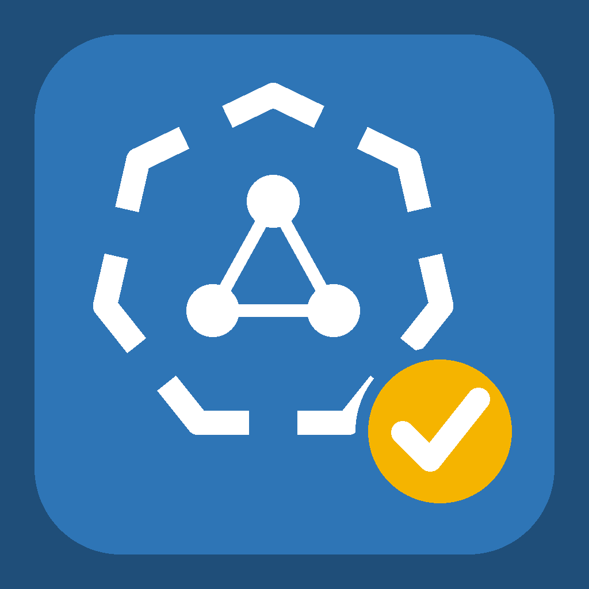
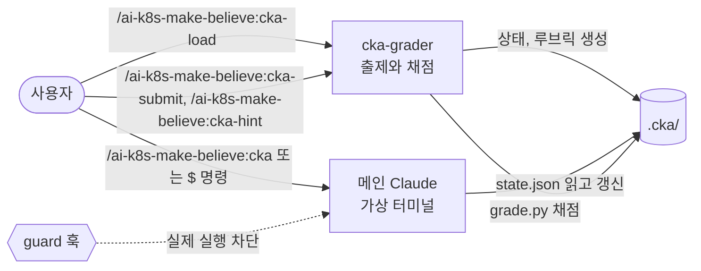

<p align="center"></p>

# ai-k8s-make-believe

> Your cluster lives in my head.

A Claude Code plugin for CKA practice without a cluster. Claude keeps a small text-based virtual state per problem, makes up realistic `kubectl`, `etcdctl`, `kubeadm` and `systemctl` output, grades your answer against a fixed rubric, and coaches you with step-by-step hints.

클러스터 없이 진짜인 척 돌아가는 CKA 연습용 비공식 시뮬레이터, 일명 **k12s**(kubernetes-less)입니다. 실제 클러스터, 컨테이너, VM은 하나도 띄우지 않습니다. Claude가 문제마다 텍스트로 된 가상 상태를 들고 터미널 출력을 지어냅니다. 문제를 낼 때 고정한 루브릭으로 채점하고 틀리면 단계별로 힌트를 줍니다.

> [!IMPORTANT]
> - 개인이 만든 비공식 프로젝트이며 CNCF, Linux Foundation과 관련이 없습니다.
> - 터미널 출력은 진짜처럼 보이지만 Claude가 지어낸 것입니다. 중요한 개념은 공식 문서와 실제 환경에서 다시 확인하세요.
> - 실제 시험 유출 문제(덤프)는 CNCF 응시 약관 위반이라 자격이 취소될 수 있습니다. 공개 연습문제나 직접 만든 문제를 쓰세요.
> - 출제 범위는 2025년 2월 개편을 기준으로 합니다. 최신 범위는 [cncf/curriculum](https://github.com/cncf/curriculum)에서 확인하세요.

## 왜 만들었나

CKA는 터미널에서 직접 푸는 시험이라 연습 환경이 필요합니다. 그런데 문제 하나 풀자고 클러스터를 띄우기는 번거롭습니다.

- kind나 k3s를 띄워도 etcd 복구, kubeadm 업그레이드, kubelet 장애 같은 노드 레벨 문제는 재현하기 어렵습니다.
- Killercoda 같은 브라우저 환경은 좋지만 세션이 짧고 내가 가진 문제를 넣어 보기 어렵습니다.
- 그냥 Claude에게 물어보면 채점 기준이 매번 달라지고 명령이 쌓이면 앞의 상태를 잊고 정답을 너무 일찍 말해 버립니다.

그래서 문제마다 상태 파일과 루브릭을 고정했습니다. 같은 답안은 매번 같게 채점되고 정답은 문제가 끝날 때까지 나오지 않습니다.

## 빠른 시작

```bash
claude plugin marketplace add jhwanchoi/ai-k8s-make-believe
claude plugin install ai-k8s-make-believe@ai-k8s-make-believe --scope user
```

이미 열려 있는 Claude Code 세션에서는 `/reload-plugins`를 실행하면 바로 쓸 수 있습니다.

연습은 전용 디렉터리에서 합니다. `.cka/` 폴더가 있는 디렉터리에서는 Claude가 실제 `kubectl` 같은 명령을 실행하지 못하게 막습니다.

```bash
mkdir -p ~/cka-practice/.cka && cd ~/cka-practice && claude
```

```
/ai-k8s-make-believe:cka-load prod 네임스페이스의 web Deployment를 web-svc라는 Service로 80 포트에 노출하라
$ kubectl get deploy,pod -n prod --show-labels
$ kubectl expose deploy web -n prod --name web-svc --port 80 --target-port 8080
/ai-k8s-make-believe:cka-submit
```

- 문제를 붙여넣어도 되고 주제만 줘도 되고(`/ai-k8s-make-believe:cka-load etcd`), 비워 두면 새로 냅니다.
- `/ai-k8s-make-believe:cka-load 오답`은 오답 노트에서 골라 변형 문제를 냅니다.
- 문제를 불러온 뒤 터미널 명령은 `$ kubectl ...`처럼 접두어 없이 바로 입력하면 됩니다.

어떻게 흘러가는지는 [예시 세션](examples/example-session.md)을 보세요.

## 구성

Claude Code는 플러그인 커맨드를 `/플러그인이름:커맨드` 형태로 등록합니다. 그래서 커맨드는 모두 `/ai-k8s-make-believe:`로 시작합니다.

| 커맨드 | 하는 일 |
|---|---|
| `/ai-k8s-make-believe:cka-load [문제 \| 파일 \| 주제 \| 오답]` | 문제를 불러오고 가상 환경과 루브릭을 만듭니다 |
| `/ai-k8s-make-believe:cka <명령>` | 가상 터미널에서 명령을 실행합니다. `$ <명령>`으로 입력해도 됩니다 |
| `/ai-k8s-make-believe:cka-submit [명령]` | 지금의 가상 상태를 루브릭으로 채점합니다 |
| `/ai-k8s-make-believe:cka-hint` | 다음 단계 힌트를 받습니다 (방향, 위치, 정답 공개 순) |
| `/ai-k8s-make-believe:cka-giveup` | 정답과 해설을 보고 문제를 정리합니다 |
| `/ai-k8s-make-believe:cka-reset` | 가상 환경을 처음 상태로 되돌립니다. 시도와 힌트 횟수는 그대로입니다 |
| `/ai-k8s-make-believe:cka-exam start \| next \| prev \| goto N \| status \| end` | 2시간 모의고사입니다. 힌트 없이 풀고 끝나면 한꺼번에 채점합니다 |

| 내부 구성 | 역할 |
|---|---|
| `cka-rules` skill | 가상 상태 스키마, 명령 해석, 출력 형식 규칙 |
| `cka-grader` agent | 출제, 채점, 힌트, 모의고사 리포트. 정답을 읽는 유일한 주체 |
| `scripts/grade.py` | 루브릭 항목을 상태 파일과 결정적으로 비교 |
| `scripts/guard.py` | 연습 디렉터리에서 실제 `kubectl` 같은 명령 실행을 막는 훅 |



## 동작 방식

- **최종 상태로 채점합니다.** imperative로 풀든 YAML로 풀든 결과가 같으면 정답입니다. 결정적으로 판단할 수 있는 항목은 `grade.py`가 보고 의미를 따져야 하는 항목만 Claude가 봅니다. 리소스가 있는지만 보지 않고 Pod가 어느 노드에 떴는지, 요청이 실제로 라우팅될 조건이 갖춰졌는지 같은 결과 상태도 봅니다.
- **정답은 메인 대화에 들어오지 않습니다.** 출제와 채점은 `cka-grader` 서브에이전트가 맡습니다. 터미널을 흉내 내는 메인 Claude는 정답을 모르기 때문에 가상 출력에 정답이 섞일 수 없습니다.
- **상태는 파일로 관리합니다.** 대화가 길어지거나 끊겨도 `.cka/`에서 이어서 풀 수 있습니다. 명령을 실행할 때는 `state.json`만 읽고 `history.md`에는 덧붙이기만 해서 명령이 쌓여도 한 턴 비용이 거의 늘지 않습니다.
- **진짜 명령은 막습니다.** `.cka/` 폴더가 있는 연습 디렉터리에서 Claude가 실수로 `kubectl`, `etcdctl`, `kubeadm`, `systemctl`, `helm`, `ssh` 등을 실제로 실행하려 하면 훅이 막습니다. 자세한 범위는 [SECURITY.md](SECURITY.md)를 보세요.
- **쓰는 언어로 답합니다.** 설명과 힌트는 질문한 언어로 하고 가상 터미널 출력은 실제 도구처럼 영어로 보여 줍니다.

```
.cka/
├── current             # 풀고 있는 문제 id
├── wrong-notes.md      # 오답 노트
└── q07-etcd-backup/
    ├── problem.md
    ├── state.json      # 가상 상태 (채점 기준)
    ├── state.init.json # 리셋용 초기 상태
    ├── history.md      # 명령 기록 (덧붙이기만 함)
    └── answer-key.md   # 정답과 루브릭 (grader 전용)
```

지금 상태는 `state.json`, 명령 기록은 `history.md`를 직접 열어 보면 됩니다. 특정 시점으로 돌아가고 싶으면 "3번 명령 전으로 되돌려 줘"처럼 말하면 됩니다.

## 필요한 것

- [Claude Code](https://claude.com/claude-code)
- `python3` (표준 라이브러리만 씁니다)
- macOS에서 확인했습니다. Linux도 같은 방식으로 동작하고 Windows에서는 WSL을 권합니다.

## 권한 확인 줄이기

Claude Code는 파일을 쓰거나 명령을 실행할 때마다 확인을 받습니다. 연습 디렉터리에 아래 파일을 두면 `.cka/` 안의 상태 파일 작업은 묻지 않고 진행합니다. 허용 범위는 `.cka/` 안으로만 좁혔습니다.

`~/cka-practice/.claude/settings.local.json`

```json
{
  "permissions": {
    "allow": [
      "Read(./.cka/**)",
      "Edit(./.cka/**)",
      "Bash(date:*)",
      "Bash(cat >> .cka/:*)"
    ]
  }
}
```

채점 스크립트 실행(`python3 .../grade.py`)과 문제 정리(`rm -rf .cka/...`)는 물어볼 때 확인해 주세요.

## 한계

- 흉내만 낼 수 있는 결과에는 `(추정)`이 붙습니다. 컨트롤러 연쇄, 스케줄링, NetworkPolicy 트래픽, 복잡한 장애가 그렇습니다. 이런 유형은 Killercoda의 CKA 플레이그라운드 같은 실제 환경으로 보완하고 시험 등록 때 받는 killer.sh 2회는 마무리 점검에 쓰는 게 좋습니다.
- 명령에 따른 상태 변화는 결국 LLM이 계산합니다. 상태가 이상하면 `history.md`의 변경 기록으로 원인을 찾을 수 있습니다.
- 트러블슈팅 문제는 `state.json`을 열면 증상이 그대로 보입니다. 스포일러가 싫으면 열지 마세요.
- 출제, 채점, 힌트 때마다 서브에이전트를 한 번 더 띄우므로 일반 대화보다 토큰을 더 씁니다. 검증은 Sonnet으로 했습니다.

## 자주 묻는 것

- **커맨드가 없다고 나와요.** 커맨드는 `/ai-k8s-make-believe:`로 시작해야 합니다. `/cka-load`처럼 앞부분을 빼면 찾지 못합니다. 설치 직후라면 `/reload-plugins`를 먼저 실행하세요.
- **연습 디렉터리에서 진짜 `kubectl`을 쓰고 싶어요.** 막는 게 의도입니다. `.cka/`가 없는 다른 디렉터리에서 쓰세요.
- **python3가 없다는 메시지와 함께 Bash가 막혀요.** 차단 훅과 채점 스크립트가 python3를 씁니다. python3가 없으면 막아야 할 명령인지 판단할 수 없어서, 연습 디렉터리에서는 안전하게 모두 막습니다. 설치한 뒤 다시 시도하세요.
- **시뮬레이션 출력이나 채점이 실제와 달라요.** [이슈](https://github.com/jhwanchoi/ai-k8s-make-believe/issues/new/choose)로 알려 주세요. 명령, 가상 출력, 실제 출력, Kubernetes 버전을 적어 주시면 지침을 고칩니다. 실제 시험 문제나 kubeconfig는 붙이지 마세요.
- **업데이트와 삭제는 어떻게 하나요.** `claude plugin update ai-k8s-make-believe@ai-k8s-make-believe`, `claude plugin uninstall ai-k8s-make-believe@ai-k8s-make-believe`.

## English quick start

```bash
claude plugin marketplace add jhwanchoi/ai-k8s-make-believe
claude plugin install ai-k8s-make-believe@ai-k8s-make-believe --scope user
mkdir -p ~/cka-practice/.cka && cd ~/cka-practice && claude
```

Then run `/ai-k8s-make-believe:cka-load <problem text or topic>`, type commands as `$ kubectl ...`, and finish with `/ai-k8s-make-believe:cka-submit`. Claude answers in the language you write in. Inside a practice directory (one that has `.cka/`), a hook stops Claude from running real cluster commands.

## 기여할 때

[CONTRIBUTING.md](CONTRIBUTING.md)를 보세요. 로컬에서 고쳐 보려면 저장소를 받아 `claude --plugin-dir ./ai-k8s-make-believe`로 띄우면 됩니다.

`skills/`와 `agents/`의 지침을 바꾸면 이 플러그인을 쓰는 모든 사람의 시뮬레이션과 채점이 바뀝니다. PR을 보내실 때는 근거가 된 Kubernetes 공식 문서나 실제 출력 예시를 함께 적어 주세요.

## 라이선스

[MIT](LICENSE)
