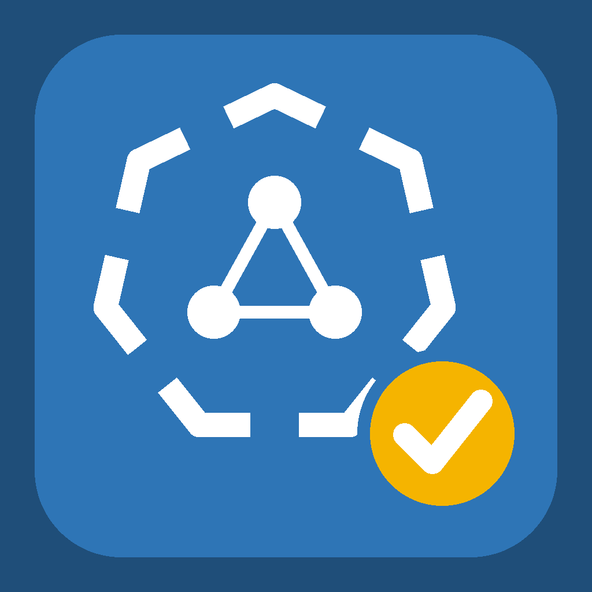
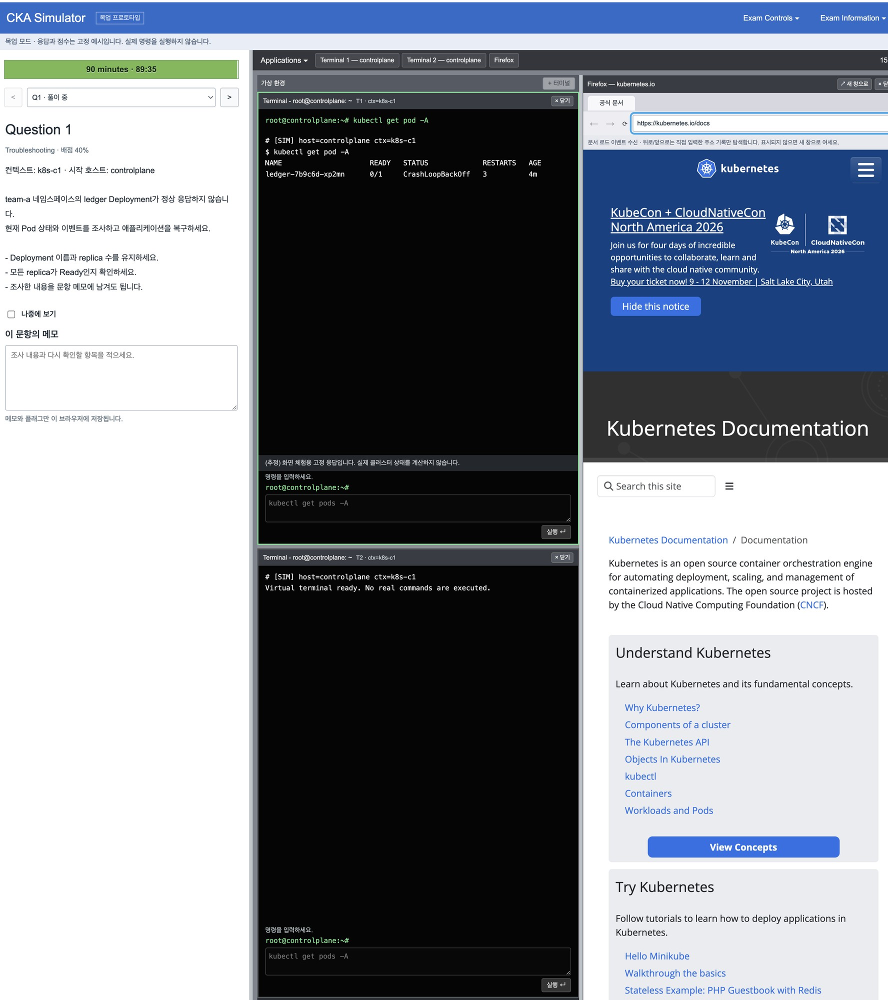
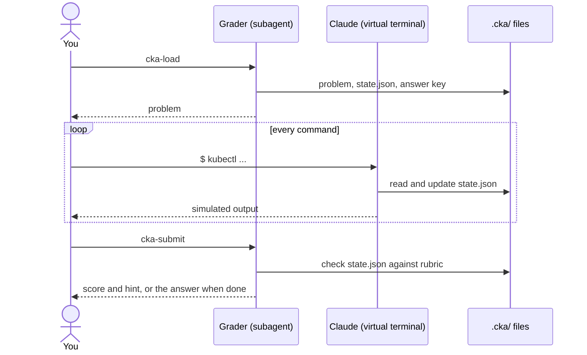

<p align="center"></p>

# ai-k8s-make-believe

> Your cluster lives in my head.

A Claude Code plugin for CKA practice **without a cluster**, a.k.a. **k12s** (kubernetes-less). No cluster, containers or VMs are started. For each problem, Claude keeps a small virtual state in text files, writes realistic `kubectl`, `etcdctl`, `kubeadm` and `systemctl` output, grades your answer against a fixed rubric, and gives step-by-step hints.

<p align="center">
  
  <br><sub>Optional web UI: question panel, virtual terminals and a docs browser, like the real exam.</sub>
</p>

> [!IMPORTANT]
> - Unofficial personal project. Not affiliated with the CNCF or the Linux Foundation.
> - Terminal output looks real but is made up by Claude. Double-check key concepts in the official docs and a real cluster.
> - Do not use leaked exam questions ("dumps"). They break the CNCF exam agreement and can get your certification revoked.
> - Problems follow the CKA curriculum as revised in February 2025. See [cncf/curriculum](https://github.com/cncf/curriculum) for the latest.

## Quick start

**1. Install**

```bash
claude plugin marketplace add jhwanchoi/ai-k8s-make-believe
claude plugin install ai-k8s-make-believe@ai-k8s-make-believe --scope user
```

If Claude Code is already open, run `/reload-plugins`.

**2. Open a practice directory**

```bash
mkdir -p ~/cka-practice/.cka && cd ~/cka-practice && claude
```

A directory with a `.cka/` folder is a practice directory. Inside it, a hook stops Claude from running real cluster commands.

**3. Solve a problem**

```
/ai-k8s-make-believe:cka-load Expose the web Deployment in namespace prod as a Service named web-svc on port 80
$ kubectl get deploy,pod -n prod --show-labels
$ kubectl expose deploy web -n prod --name web-svc --port 80 --target-port 8080
/ai-k8s-make-believe:cka-submit
```

- Paste a full problem, give a topic (`/ai-k8s-make-believe:cka-load etcd`), or leave it empty for a new one.
- Once a problem is loaded, type commands starting with `$`.
- Claude explains and hints in the language you write in. Terminal output stays in English, like the real tools.

See a full run in the [example session](examples/example-session.md) (Korean).

## How it works



- **State lives in files, not in chat memory.** Each command reads and updates `state.json`, so results stay consistent and you can resume anytime.
- **The answer stays with the grader.** A separate subagent writes the problem, holds the answer key and grades. The terminal side is told not to read it. This is an instruction, not a permission boundary.
- **Graded on the final state.** Imperative commands or YAML, any path that reaches the right state passes. `grade.py` checks what can be checked exactly, and Claude judges the rest. It checks results such as which node a Pod runs on, not only whether a resource exists.
- **A second look.** After a problem is created and before grading, a reviewer subagent checks the setup and the simulated state changes against real Kubernetes behavior. You decide whether to apply its fixes.
- **Real commands are blocked.** In a practice directory, a hook blocks `kubectl`, `etcdctl`, `kubeadm`, `systemctl`, `helm`, `ssh` and similar commands. See [SECURITY.md](SECURITY.md).

## Commands

All commands start with `/ai-k8s-make-believe:`.

| Command | What it does |
|---|---|
| `cka-load [text \| file \| topic \| 오답]` | Load a problem. `오답` ("wrong answers") makes a variant of a problem you missed before |
| `cka <command>` or `$ <command>` | Run a command in the virtual terminal |
| `cka-submit [command]` | Grade the current virtual state. A command given here runs first |
| `cka-hint` | Get the next hint: a search term for the official docs (checked against the page), then direction, then location, then the answer |
| `cka-giveup` | Show the answer and explanation, then archive the problem |
| `cka-reset` | Reset the virtual environment. Attempt and hint counts stay |
| `cka-exam start \| next \| prev \| goto N \| status \| end` | 2-hour mock exam. No hints, graded at the end. Retakes are logged as attempts |

## Web simulator (optional)

Practice in an exam-style screen with a question panel, terminals and a docs browser. The page is only a front end. A local server sends each action to a background Claude Code session running this plugin.

```bash
python3 simulator/server.py --practice ~/cka-practice   # open http://127.0.0.1:8765/
```

- Each command takes a few seconds. Loading, submitting and ending an exam can take a few minutes.
- Every call uses Claude, about $0.02–0.03 per command. The default model is Sonnet; change it with `--model`.
- The server listens on 127.0.0.1 only and never sends answer or setup files to the browser before the exam ends.
- Opening `simulator/static/` with any static server gives a mock with fixed responses.

<details>
<summary>Use a real Firefox for docs (Docker)</summary>

The built-in docs window is an iframe, so kubernetes.io search results do not open in it. With Docker you can run a real Firefox limited to the allowed docs (kubernetes.io/docs, /blog, helm.sh/docs, gateway-api.sigs.k8s.io):

```bash
docker run -d --name cka-firefox -p 127.0.0.1:5800:5800 \
  -e FF_OPEN_URL=https://kubernetes.io/docs/ -e ENABLE_CJK_FONT=1 \
  --add-host www.google.com:0.0.0.0 --add-host google.com:0.0.0.0 --add-host cse.google.com:0.0.0.0 \
  -v "$PWD/simulator/firefox/policies.json:/usr/lib/firefox/distribution/policies.json:ro" \
  jlesage/firefox
python3 simulator/server.py --practice ~/cka-practice --browser-url http://127.0.0.1:5800/
```

Stop it with `docker stop cka-firefox` and start it again with `docker start cka-firefox`. The image is about 1 GB.
</details>

## Import a problem repo

Give Claude a link to a public practice repo, and it creates the problem, solution and setup files in `./exams/` of your practice directory:

```
Make problem and answer files from https://github.com/<owner>/<repo>
```

Repos in the CKA-PREP layout (`Question-<n> <topic>/Questions.bash`) are converted by a script; other layouts are written by Claude and format-checked. Keep these files local and do not commit them here. Claude warns you if a source looks like copied exam content.

## Limitations

- Results Claude can only approximate are marked `(추정)` ("estimated"): controller chains, scheduling, NetworkPolicy traffic and complex failures. Practice those in a real environment such as Killercoda, and save your two killer.sh sessions for the final check.
- `kubectl` commands and flags are checked against an index of the official v1.37 reference. `etcdctl`, `kubeadm` and `crictl` rely on Claude's knowledge.
- State changes are computed by an LLM, and so is the review. If something looks off, check `history.md` in the problem folder.
- For troubleshooting problems, `state.json` shows the symptoms. Do not open it if you want to avoid spoilers.
- Each load, submit and hint starts a subagent, so it uses more tokens than a plain chat.

<details>
<summary>What is in <code>.cka/</code></summary>

```
.cka/
├── current             # id of the problem in progress
├── wrong-notes.md      # notes on missed problems
├── exam-attempts.jsonl # mock exam attempts
├── archive/            # finished problems
└── q07-etcd-backup/
    ├── problem.md
    ├── state.json      # virtual state (what gets graded)
    ├── state.init.json # initial state for reset
    ├── history.md      # command log (append-only)
    ├── answer-key.md   # answer and rubric (grader only)
    └── diagram.md      # before/after diagram, created when the problem ends
```

To go back a few steps, say something like "undo the last 3 commands". Claude rewinds using `history.md`, which may not be exact. For a clean restart, use `cka-reset`.
</details>

<details>
<summary>Fewer permission prompts</summary>

Put this in `~/cka-practice/.claude/settings.local.json` to allow state file work inside `.cka/` without asking:

```json
{
  "permissions": {
    "allow": [
      "Read(./.cka/**)",
      "Read(~/.claude/plugins/cache/ai-k8s-make-believe/**)",
      "Edit(./.cka/**)",
      "Bash(date:*)",
      "Bash(cat >> .cka/:*)",
      "WebSearch",
      "WebFetch(domain:kubernetes.io)"
    ]
  }
}
```

Grading and diagram scripts and archiving finished problems still ask first. Finished problems are never deleted, so clean up `.cka/archive/` yourself.
</details>

## Requirements

- [Claude Code](https://claude.com/claude-code)
- `python3` (standard library only)
- Tested on macOS. Linux works the same way; on Windows, use WSL.

## FAQ

- **"Unknown command".** Commands need the `/ai-k8s-make-believe:` prefix. Right after installing, run `/reload-plugins`.
- **Typing `:wq` closed Claude Code.** Claude Code treats a bare `:wq` or `:q` as an exit command. After `vim <file>` or `kubectl edit` in the terminal, paste the whole edited content as your next message; that counts as `:wq`. To quit without saving, type `$ :q!`. The web simulator has a real vim editor, so `:wq` works there.
- **I want to use real `kubectl` here.** Blocking it is intended. Use a directory without `.cka/`.
- **Bash is blocked with a python3 message.** The hook needs `python3` to decide what to block, so without it everything is blocked in practice directories. Install `python3` and try again.
- **Simulated output or grading is wrong.** [Open an issue](https://github.com/jhwanchoi/ai-k8s-make-believe/issues/new/choose) with the command, the simulated output, the real output and the Kubernetes version. Do not paste real exam questions or kubeconfigs.
- **Update or uninstall.** `claude plugin update ai-k8s-make-believe@ai-k8s-make-believe` or `claude plugin uninstall ai-k8s-make-believe@ai-k8s-make-believe`.

## Contributing

See [CONTRIBUTING.md](CONTRIBUTING.md). To try local changes, clone the repo and run `claude --plugin-dir ./ai-k8s-make-believe`. The web simulator architecture is in [docs/architecture.png](docs/architecture.png) (Korean).

Changes to `skills/` and `agents/` change simulation and grading for everyone. Please include links to the Kubernetes docs or real output that back your change.

## License

[MIT](LICENSE)
