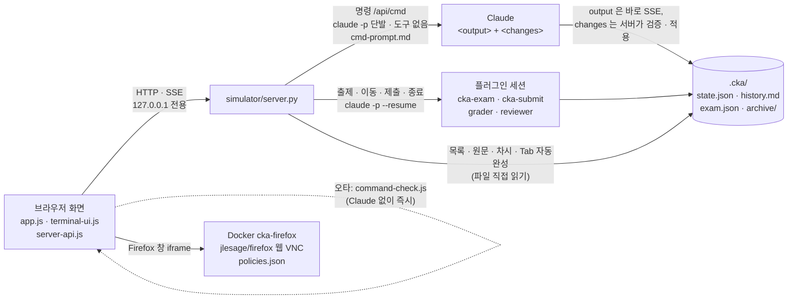

# CKA 시뮬레이터 UI/UX

## 0. 컨셉

실제 CKA 시험 화면을 그대로 연습한다. 실제 시험은 PSI 전용 브라우저 안에서 왼쪽에 문제 패널, 오른쪽에 원격 Linux 데스크톱(터미널과 진짜 Firefox)을 보여 준다. 이 화면도 같은 배치를 쓰되 클러스터는 없다. 터미널 명령의 결과와 상태 변화는 Claude 가 문제마다의 가상 상태(`.cka/<id>/state.json`)로 계산하고, 채점은 플러그인 grader 가 루브릭으로 한다. 서버(`simulator/server.py`) 없이 정적으로 열면 고정 응답을 내는 **정적 목업 모드**로 동작한다.

원칙

- **실제와 같게.** 프롬프트, 출력 형식, 에러 문구, 단축키, 문서 브라우저 동작을 실제 시험 환경(Linux 터미널 · bash · Firefox)에 맞춘다. 시뮬레이터라서 생기는 표시(`# [SIM]` 머리줄, 명령 반복)는 응답에 남기되 화면에는 그리지 않는다.
- **기다림을 보여 준다.** Claude 호출은 명령 수 초, 출제 1~2분이 걸린다. 시작 진행 표시와 터미널 경과 초로 멈춘 것이 아님을 알린다. Claude 가 필요 없는 일(오타, Tab 자동완성, 목록, 차시 기록)은 즉시 처리한다.
- **정답은 끝나기 전에 보이지 않는다.** 풀이 · 환경 파일 · answer-key 는 시험이 끝나기 전 브라우저 응답, DOM, localStorage 어디에도 넣지 않는다. 명령을 처리하는 Claude 호출에도 넣지 않는다.
- **상태는 파일에 있다.** 시험 · 문제 · 기록은 연습 폴더 `.cka/` 에 있어서 서버를 다시 띄워도 이어진다.

## 구조

- 명령은 Claude 를 한 번만 부른다. 입력은 cmd-prompt.md(규칙) + problem.md + state.json + 최근 기록 + 해당 kubectl 색인 + `# terminal=<n> host=<host>` + 명령이다. 응답의 `<output>` 은 받는 대로 화면에 흘리고, `<changes>` 는 서버가 `clusters` · `hosts` · `meta` 아래인지 검증해 state.json 에 원자적으로 적용하고 cmd_count · history 를 기록한다. 이유: 도구 왕복 없이 명령당 2~5초로 줄이고, 상태 변경을 코드가 기록한다.
- 출제 · 문항 이동 · 제출 · 종료는 시험마다 하나인 플러그인 세션(`--resume`)이 맡는다. 서버는 headless 라 묻는 대신 리뷰 이상을 "무시"로 처리하고 결과만 남긴다. 이유: 정답을 보는 일은 grader 서브에이전트에 격리한다.
- Claude 호출은 사용자 전역 설정을 읽지 않는다(`--setting-sources project,local`). 플러그인 guard 훅은 그대로 동작한다. 요청은 한 번에 하나다.
- 서버를 `--browser-url` 과 띄우면 화면 안 Firefox 창이 Docker 컨테이너의 진짜 Firefox 화면을 보여 준다(§2-1).

| HTTP | JS (`window.MockAPI`) | 하는 일 |
|---|---|---|
| GET /config.js | — | 서버 모드 표시(`SIM_SERVER`), 연습 폴더(`SIM_PRACTICE`), 문서 브라우저 주소(`SIM_BROWSER`) |
| GET /api/exams | serverCatalog() | 연습 폴더 exams/ 목록(문항 수 · 풀이 유무 · 차시 수) |
| GET /api/exam-file?name= | serverCatalog() | 문제 원문만. 풀이 · 환경 파일, 경로 이탈은 404 |
| GET /api/attempts | attempts() | `.cka/exam-attempts.jsonl` 차시 기록 |
| GET /api/exam | getExam() | 진행 중 시험 요약 또는 null (이어 풀기 판단) |
| GET /api/complete?host= | complete({host}) | Tab 자동완성용 가상 파일 경로 · 객체 이름 · 노드 |
| POST /api/exam/start {file, answers, minutes} | startExam() | 플러그인 `cka-exam start`, 1번 문제 출제 |
| POST /api/cmd {text, terminal, host, local_output?} → SSE | cmd() | 명령 한 번 처리. `local_output` 이면 Claude 없이 기록만 |
| POST /api/exam/goto {n} | gotoExam() | 플러그인 `cka-exam goto` |
| POST /api/submit | submit() | 플러그인 `cka-submit` (모의고사는 "제출 기록됨"만) |
| POST /api/exam/end | endExam() | 플러그인 `cka-exam end`, 리포트 · 풀이(이때만) |

POST 는 `X-Sim: 1` 헤더와 Host 가 127.0.0.1/localhost 인 요청만 받는다. 이유: 다른 사이트가 브라우저를 통해 로컬 서버를 부르지 못하게 한다.

## 터미널

- 실제 터미널처럼 마지막 출력 바로 아래 줄의 `root@<host>:~# ` 뒤에서 입력한다. 입력 상자 테두리 · 실행 버튼 · 안내 문구는 없다. 터미널 화면 아무 곳이나 누르면 입력으로 간다(글자를 고르는 중이면 그대로). 프롬프트는 초록, 명령과 출력은 흰색. 입력 줄은 내용만큼 늘어난다. 이유: 실제 시험 터미널과 같은 시선 흐름.
- Enter 는 실행한다. 단 bash 처럼 입력이 끝나지 않았으면(닫히지 않은 heredoc, 줄 끝 `\`, 닫히지 않은 따옴표) 줄바꿈하고 다음 줄은 `> ` 로 이어 보여 준다. Shift+Enter 도 줄바꿈이다. 빈 Enter 는 새 프롬프트만 찍는다. IME 조합 중 Enter 는 실행하지 않는다.
- 실행 중에는 프롬프트를 숨기고 경과 초를 보여 준다. `clear` 와 Ctrl+L 은 화면만 지운다(명령을 보내지 않는다).
- Tab 은 bash 처럼 완성한다: 명령 이름, kubectl 하위 명령 · 플래그(공식 v1.37 색인), 리소스 종류와 이름, `-n` 뒤 네임스페이스, `-f` 뒤 · 일반 경로(`~` 는 /root). 하나면 채우고, 여럿이면 공통 부분까지 채운 뒤 후보를 아래에 보여 준다. 경로와 이름은 `/api/complete` 로 현재 문제 state.json 에서 가져오고 명령을 실행할 때마다 새로 읽는다. Claude 를 부르지 않는다.
- 없는 명령 · kubectl 하위 명령 · 플래그는 브라우저 command-check 가 실제 형식 에러(`kbuectl: command not found`, `error: unknown flag: --foo`)로 즉시 답하고 서버는 기록만 한다. kubectl 색인에 별칭이 없어 `create deploy` 처럼 확신할 수 없는 경우는 판정하지 않고 Claude 에 보낸다.

| 키 | 동작 |
|---|---|
| Enter / Shift+Enter | 실행 / 줄바꿈 (위 이어 쓰기 규칙) |
| Tab | 자동완성 |
| ↑ ↓ | 명령 이력 (한 줄일 때), 끝에서 작성 중 초안으로 |
| Ctrl+Shift+C / Ctrl+Shift+V | 복사 / 붙여넣기 (실제 시험 안내와 같음). Mac 은 Cmd+C/V 도 됨 |
| Ctrl+C | 입력 취소, `^C` 표시 후 새 프롬프트 |
| Ctrl+L, `clear` | 화면 지우기 |
| Ctrl+U / Ctrl+K / Ctrl+W | 줄 처음까지 / 줄 끝까지 / 앞 단어 지우기 |
| Ctrl+A / Ctrl+E | 줄 처음 / 끝으로 |
| Ctrl+D | 빈 줄이면 `exit`, 아니면 커서 글자 지우기 |
| Alt+← / Alt+→ | 이전 / 다음 문항 (입력에 포커스가 없을 때) |
| Alt+Shift+T | 터미널 1 ↔ 2 전환 |
| Shift+Tab | 포커스 이동 (Tab 은 자동완성이 씀) |

이유: Windows 에서 Ctrl+C 는 원래 복사지만, 실제 시험 Linux 터미널처럼 취소로 쓴다. `^C` 와 `clear` 는 화면에만 남는 동작이라 이어 풀기 때 다시 그리지 않는다.

## 1. 시작 화면

- 왼쪽에 사용 목적과 3단계 흐름, 오른쪽에 시작 폼을 둔다. 이유: 처음 온 사용자가 가상 연습임을 이해하고 바로 시작할 수 있다.
- `.md` 파일은 브라우저에서 파싱한다. `# 제목`, 연속된 `## Q1` 번호, `domain:`, `weight:`, 빈 줄, 원문을 요구한다. 배점은 양의 정수이고 합계 100이며 최대 파일 크기는 1MiB다. 이유: 시험 전에 누락과 배점 오류를 발견한다.
- 문항 수와 각 도메인·배점을 미리 보여 주고 유효한 파일만 시작 가능하게 한다. 이유: 잘못 고른 파일로 시간을 소비하지 않는다.
- 시험 시간은 정수 1~360분, 기본 90분이다. 이유: 짧은 UX 체험과 긴 연습을 같은 폼에서 지원한다.
- 폴더 흐름에서는 풀이 파일을 자동 연결한다. “파일 직접 고르기”에서는 풀이 파일(선택, `.answers.md`)을 문제 파일 아래에서 별도로 고른다. `# 제목`·머리말 뒤 `## Q<n>`마다 bash 블록과 `(원본: [이름](URL))`을 파싱하며 내용 대신 문항 개수만 미리 보여 준다. 문제와 개수가 다르면 경고하고 시작은 허용한다. 잘못된 형식은 이유를 안내하고 풀이 없이 시작할 수 있다. 이유: 파일 짝을 확인하면서 부분 풀이도 사용할 수 있다.
- 예시 시작은 풀이를 고른 상태여도 항상 풀이 없이 시작한다. 이유: 기존 예시 흐름을 유지한다.
- 예시 시작은 mock-api.js에 내장한 `examples/mock-01.md` 복사본을 쓴다. 원본 변경 시 복사본도 갱신해야 한다. 이유: 지정된 static 루트만 제공해도 예시를 불러온다.
- 시작 요청 중 문제·풀이 파일 선택과 시작 버튼을 잠그고, 버튼 바로 아래에 회전 표시와 경과 초("Claude 가 1번 문제 환경을 만드는 중 · 37초 (보통 1~2분)")를 보여 준다. 오류는 상단에 남기고 폼을 다시 활성화한다. 이유: 1~2분 걸리는 출제를 멈춤으로 오해하지 않고, 중복 시작을 막는다.

## 2. 시험 화면: Question + 데스크톱

- 기준은 사용자가 요약한 killer.sh 스크린샷이다. 맨 위 파란 바 왼쪽은 글자 `CKA Simulator`, 오른쪽은 `Exam Controls ▾`, `Exam Information ▾`다. 로고·상표 이미지는 사용하지 않는다. 이유: 요청한 시험 화면의 공간 구성을 단순한 문자와 색으로 재현한다.
- Exam Controls에는 [이 문항 제출], [시험 종료]만 둔다. Exam Information에는 허용 문서 네 곳, 검색 규칙, 실제 시험 모니터 하나 제한, 단축키 목록을 둔다. 기존 상단 탐색·제출·브라우저 버튼은 중복 배치하지 않는다. 이유: 시험 제어와 안내를 스크린샷의 메뉴 구조에 모은다.
- 왼쪽 흰 Question 열 위에는 남은 시간 비율 막대와 남은 분·분:초 표시, 바로 아래 `< / 문항 select / >`를 둔다. 10분 이하는 황색, 5분 이하는 적색이다. 그 아래 `Question N`, domain·weight, 원문, 제출 기록 메시지, 메모·플래그를 둔다. 이유: 시간·이동·문제 읽기의 시선을 한 열에 유지한다.
- select에 `미방문 · 풀이 중 · 제출함`과 `🚩 나중에 보기`를 표시하며 문항 칩은 없앤다. 최초 문항과 이동 성공 문항을 방문 처리하고 `meta.submitted`가 true면 제출함을 우선한다. 이유: 한 가지 탐색 수단으로 진행 상태를 확인하고 이동한다.
- 시험 중 정답·루브릭·힌트는 화면·DOM·시험 API 응답 어디에도 넣지 않는다. 선택한 풀이 원문은 메모리 변수에만 보관하며 localStorage에는 쓰지 않는다. 문제 원문은 줄바꿈을 보존한 텍스트로 표시하며 HTML을 실행하지 않는다. 이유: 정답 격리와 업로드 파일의 안전한 표시를 유지한다.
- Question | 데스크톱의 기본 폭은 약 28% | 72%다. 경계를 드래그하거나 포커스 후 좌우 화살표로 2%씩 조절한다. 이유: Question은 읽을 폭을 갖고 데스크톱은 두 창을 배치할 공간을 얻는다.
- 오른쪽 데스크톱 위는 어두운 회색 작업 표시줄이다. `Applications ▾`에 Terminal·Firefox를 두고, 열린 터미널 이름 버튼·Firefox 열기 버튼·현재 시각을 둔다. Terminal 메뉴와 [+ 터미널]은 같은 추가 동작을 수행하며 최대 두 개다. 작업 표시줄 터미널 버튼은 해당 입력으로 포커스를 옮긴다. 이유: 데스크톱에서 앱을 여는 흐름을 재현한다.
- 터미널은 검정 바탕과 초록 프롬프트를 쓰고 머리는 `Terminal - root@<host>: ~`와 터미널 번호·ctx·닫기다. 기존 host 분리·같은 host 안의 context 공유·문항별 분할·큐는 유지한다. 이유: 창 외형만 바꾸고 기존 풀이 동작을 보존한다.
- Firefox는 처음 닫혀 있다. Applications → Firefox 또는 작업 표시줄 Firefox 버튼으로 열면 터미널 오른쪽 열에 나타난다. 닫으면 터미널이 데스크톱 전체 폭을 쓴다. 문항 이동·닫기 후 다시 열기는 문서 위치를 보존하고 새 시험에서는 닫힌 상태로 시작한다. 이유: 응시자가 필요할 때 문서를 직접 연다.
- Firefox는 제목·새 창으로·닫기, 탭 하나, 주소창과 ← → ⟳, 공식 문서 iframe 하나로 구성한다. 첫 주소는 `https://kubernetes.io/docs`다. 시뮬레이터와 출처(location.origin)가 다른 http/https 주소만 Enter로 이동하며 사이트 바로가기 탭·문항별 문서 추천은 제공하지 않는다. 이유: 응시자가 직접 주소·검색·링크를 찾아 쓰는 흐름을 유지한다.
- 터미널 | Firefox 경계는 기본 50:50이며 드래그나 좌우 화살표로 조절한다. 터미널 1 | 2는 위아래 경계를 유지한다. 최소 폭·높이보다 좁은 화면은 스크롤을 제공한다. 이유: 세 경계를 독립적으로 조절하면서 창의 조작 영역을 보장한다.
- 시작 화면과 Exam Information에 허용 문서 네 곳(kubernetes.io/docs, kubernetes.io/blog, helm.sh/docs, gateway-api.sigs.k8s.io)을 글로 알리고 “kubernetes.io 검색은 되지만 외부 검색 결과는 열 수 없습니다”를 표시한다. iframe 모드에서는 외부 이동을 강제 차단하지 않고, Firefox 스트리밍 모드에서는 Firefox 정책이 차단한다(§2-1). 이유: 규칙 안내와 응시자의 문서 선택 책임을 유지한다.
- [↗ 새 창으로]는 주소창의 마지막 이동 주소를 `window.open(url, 'cka-docs')`로 연다. 같은 주소의 열린 창은 focus로 가져오고 주소가 바뀌면 같은 이름의 창에 새 주소를 연다. 열린 창의 opener를 null로 설정하며 폴백 링크에도 rel="noopener"를 둔다. 차단되면 대체 링크를 표시한다. 이유: 실제 브라우저 기능이나 별도 모니터를 이용할 수 있게 한다.
- 시작 화면에는 “브라우저 창은 다른 모니터로 옮기거나 옆에 붙여 쓰세요. 실제 시험은 모니터 하나만 허용됩니다.”를 유지한다. 이유: 연습 배치와 실제 시험 제약을 함께 알린다.

### Firefox iframe 모드의 브라우저 보안 한계

iframe 내부 링크로 이동한 주소는 교차 출처이므로 주소창·제목에 반영할 수 없다. 주소창·새 창으로·대체 링크는 마지막으로 입력해 이동한 주소를 쓴다. ← →는 이 창에서 직접 입력·이동한 주소 스택의 인덱스를 바꾸고 iframe src를 갱신한다. 뒤로 간 뒤 새 주소를 입력하면 앞으로 기록을 지운다. iframe 내부 링크 이동은 주소 스택에 기록할 수 없으며, 부모 페이지의 history는 호출하지 않는다. ⟳는 주소 스택의 현재 주소를 다시 불러온다. iframe 차단 헤더·네트워크 오류는 읽을 수 없으므로 로드 이벤트도 표시 성공을 보증하지 않는다고 안내한다. 이유: 실제 브라우저와 동일한 동작으로 오해하지 않도록 한계를 드러내고 시험 페이지 이탈을 피한다.

### 2-1. Firefox 스트리밍 모드 (권장)

- iframe 모드에서는 kubernetes.io 검색 결과를 클릭해도 열리지 않는다. 결과 링크가 `target=_parent`(감싼 창을 이동)라서 sandbox 가 막고, 막지 않으면 시험 화면 전체가 문서로 바뀐다. 다른 출처 페이지라 링크를 고칠 수도 없다.
- 그래서 실제 시험처럼 따로 도는 진짜 Firefox 의 화면을 보여 준다. Docker 컨테이너 `cka-firefox`(jlesage/firefox, 웹 VNC, 127.0.0.1:5800)를 띄우고 서버를 `--browser-url http://127.0.0.1:5800/` 로 열면 Firefox 창이 그 화면을 iframe 으로 보여 주고, 우리 주소창 · ← → ⟳ · 새 창 · 상태줄 · 가짜 탭은 숨긴다(진짜 Firefox 것을 쓴다). 옵션이 없으면 iframe 모드 그대로다.
- 스트리밍 주소에 `resize=remote` 를 붙여 원격 화면 크기를 Firefox 창 크기에 맞춘다. 이유: 웹 VNC 는 창이 원격 화면보다 좁으면 축소 모드가 돼 글자가 작아진다.
- `simulator/firefox/policies.json` 의 WebsiteFilter 로 kubernetes.io docs · blog · search, helm.sh/docs, gateway-api.sigs.k8s.io 만 열고 나머지는 Firefox 차단 화면을 띄운다. 컨테이너에서 Google 을 막아 두면 kubernetes.io 가 자체 검색(Pagefind)을 써서 검색 결과가 같은 탭에서 열린다. 이유: 실제 시험의 허용 리소스 정책과 같게 한다.
- 실행 방법은 README "문서 브라우저(진짜 Firefox)" 를 따른다. 한글 입력과 클립보드 공유는 웹 VNC 를 거친다.

## 3. CLI와 상태

- 프롬프트는 `root@<host>:~#`이며 문항 × 터미널별 기록·이력·입력 초안을 메모리에 분리한다. 3~4 backtick console 블록 각각의 첫 줄 `[SIM] host=… ctx=…`만 읽고 마지막 유효 머리줄을 반영한다. 명령 에코나 일반 본문은 머리줄로 해석하지 않는다. 이유: 문항 이동 후 작업 맥락과 입력을 복원한다.
- 입력 · Enter · 단축키 · Tab 자동완성은 위 "터미널" 절을 따른다. 다중 행에서 ↑↓는 커서 이동을 유지한다. 이유: 한국어 입력과 YAML 편집을 방해하지 않는다.
- Alt+←/→는 이전·다음 문항이다. textarea·input·select에 포커스가 있으면 문항 이동을 건너뛴다. 문항 select에도 플래그를 표시한다. 이유: 키보드 탐색과 보류 문항 재방문을 빠르게 한다. 브라우저·OS 단축키 충돌 시 버튼을 사용한다.
- 명령 요청 중에는 해당 터미널만 입력·실행·닫기를 잠그고 경과 초와 대기/수신 상태를 표시한다. 다른 터미널은 입력과 실행 예약이 가능하다. 문항 이동·제출·종료는 전체 명령 큐가 비워질 때까지 잠근다. 입력 텍스트는 성공까지 보존한다. 이유: 수 초의 Claude 응답을 멈춤으로 오해하지 않고 재시도할 수 있다.
- 스트리밍 중에는 받은 문자열을 점진적으로 표시한다. 완성된 console 펜스의 내용은 터미널에, 나머지 설명은 아래 회색 보조 줄에 표시한다. console 블록이 없으면 전체를 터미널에 표시한다. 펜스 첫 줄 `# [SIM] host= ctx=` 와 입력한 명령의 `$ ` 반복 줄은 host 추적에만 쓰고 화면에는 그리지 않는다. 다른 `$ ` 줄(여러 줄 입력)은 프롬프트 줄로 바꿔 그린다. 서버 모드의 명령 응답은 터미널 출력만 담는다. 이유: 실제 터미널과 같은 화면을 유지하면서 응답 형식은 플러그인과 같게 둔다.
- 터미널은 하단을 보고 있을 때만 자동 스크롤한다. 이유: 과거 출력을 읽는 동안 새 응답이 화면을 빼앗지 않는다.
- 연결 오류는 기록과 상단에 표시하고 입력을 유지한다. 자동 재전송은 하지 않는다. 이유: 실제 연결로 교체할 때 변경 명령의 중복 적용을 피한다.
- 남은 시간은 `minutes × 60 - pause를 제외한 실제 경과 초` 하나로 계산하고 UI와 목업 API 입력 차단에 함께 쓴다. `ends_at`은 조회 시 이 남은 시간에서 다시 계산한 호환용 시각이다. 10분 이하는 황색, 5분 이하는 적색이며 0에서는 즉시 잠근다. 이유: 별도 카운터의 시간 오차를 피한다.
- 시간이 만료되면 종료 확인을 열고 계속 풀기를 제거한다. 이미 보낸 응답은 마무리한 뒤 종료할 수 있다. 이유: 진행 중 요청과 종료 요청의 경합을 피한다.

## 4. 종료 확인과 리포트

- 종료 확인은 모달 dialog로 띄우고 보류 문항 수와 복귀 불가 안내를 표시한다. 계속 풀기와 종료 버튼을 제공한다. 이유: 실수로 끝내는 것을 방지한다.
- 종료 요청 동안 버튼을 잠그고 채점 대기를 표시한다. 만료 뒤에는 종료 버튼을 활성 상태로 유지하고 요청 처리 중에만 잠근다. 만료 dialog가 Esc 등으로 닫히면 다시 띄우지 않고 상단 알림("시간 만료 — Exam Controls ▸ 시험 종료로 리포트를 보세요")을 남긴다. Chrome 은 사용자가 닫은 모달을 페이지가 다시 띄워 가두는 것을 막아(close 이벤트에서 showModal 해도 두 번째부터 무시됨, Chrome 157 확인) 출구는 활성 상태의 종료 버튼이 맡는다. cancel 차단에는 의존하지 않는다. 실패하면 모달에서 재시도한다. 이유: 리포트 준비 상태와 복구 경로를 명확히 한다.
- 리포트는 총점·66% 합격선·문항별 획득 점수/배점·도메인별 획득률과 약점 문구를 표시한다. 모든 점수는 고정 목업이라고 반복 표기한다. 이유: 사용자가 체험 점수를 실제 평가로 해석하지 않는다.
- 풀이 파일이 있으면 문항 행에 [풀이 보기]를 표시한다. 클릭하면 바로 아래 행에 어두운 고정폭 bash 블록과 새 탭 원본 링크를 만들고 다시 클릭하면 접는다. 파일이 없으면 “풀이 파일을 고르지 않았습니다”를 회색으로 표시하며 부분 파일의 누락 문항은 별도 안내한다. 이유: 시험이 끝난 뒤에만 문항별로 복습한다.
- 풀이 코드는 textContent로 표시해 HTML과 명령을 실행하지 않고, 원본 링크는 http/https만 허용하며 새 탭에 noopener/noreferrer를 설정한다. 이유: 업로드 파일을 안전하게 읽는다.
- 새 시험 시작 및 시작 화면 복귀 시 이전 리포트 행을 비워 숨은 풀이 DOM도 제거한다. 이유: 이전 회차의 풀이가 다음 시험 중 DOM에 남지 않는다.
- 시작 화면으로 돌아가면 저장된 진행 중 시험을 이어 풀거나 새 시험을 시작한다. 메모·플래그·풀이 진행은 시험 이벤트 JSONL로 localStorage에 남긴다. 이유: 반복 연습 시 개인 기록을 유지한다.

## 5. 접근성과 보관

- 밝은 문제 패널과 어두운 CLI에 대비 높은 텍스트를 쓰고 색 변화와 시간 숫자를 함께 제공한다. 이유: 색만으로 긴급 상태를 전달하지 않는다.
- 모든 폼에 label, 버튼에 명시적 이름, 키보드 포커스 테두리를 제공한다. 로딩·오류는 status로 알리고 스트리밍 본문은 반복 낭독을 강제하지 않는다. 이유: 키보드·보조기기 사용자에게 조작과 상태가 드러난다.
- dialog는 기본 포커스 가두기를 사용하고 문항 이동 시 제목, 리포트 진입 시 리포트로 포커스를 옮긴다. 이유: 화면 변화 후 현재 위치를 파악한다.
- 애니메이션은 reduced-motion을 존중한다. 이유: 대기 표시의 불필요한 움직임을 줄인다.
- localStorage 읽기·쓰기는 try/catch로 보호하고 실패 시 메모리로 유지하며 안내한다. 터미널 기록과 시험 상태는 새로고침 뒤 이벤트 재생으로 복원한다. 이유: 저장소 제한으로 시험 조작이 중단되지 않도록 한다. beforeunload 경고는 제거한다. 진행은 저장되며 pagehide에서 메모를 즉시 기록하고 pause를 남겨 재개할 수 있기 때문이다. 브라우저가 강제 종료되어 이벤트가 실행되지 않으면 마지막 기록 시각을 기준으로 중단을 복구한다.

## 6. API 교체 경계와 체험

모든 API 요청은 `window.MockAPI`에만 있다. 서버 모드에서는 `server-api.js`가 같은 이름의 메서드를 fetch · SSE 구현으로 바꿔 끼운다(실서버 API 표는 위 "구조" 절). app.js는 fetch나 서버 파일을 직접 읽지 않는다. 문항 파싱과 예시 파일 취득도 같은 파일의 로컬 유틸리티다. 반환 데이터는 exam.json의 `started_at`, `ends_at`, `current`, `problems`를 유지하고 표시용 host/기본 context/host별 contexts/title, 문항별 visited와 목업 state의 meta.submitted를 추가한다. 방문·제출 상태는 새 시험마다 초기화하며 이어 풀기에서는 이벤트에서 복원한다.

| HTTP 계약 | JS 계약 | 반환 |
|---|---|---|
| GET /api/exam | getExam() | Promise<시험 요약 또는 null> (서버 모드에서 이어 풀기 판단에 사용) |
| POST /api/exam/resume {log, answers?} | resumeExam({log, answers}) | Promise<exam, questions, preferences, timing> |
| POST /api/exam/start {file, answers, minutes} | startExam({file, answers, minutes}) | Promise<시험 요약> |
| POST /api/cmd {text, terminal, host} → SSE | cmd({text, terminal, host}) | AsyncIterable<마크다운 문자열 델타> |
| POST /api/exam/goto {n} | gotoExam({n}) | Promise<시험 요약> |
| POST /api/submit | submit() | Promise<message: "제출 기록됨", exam> |
| POST /api/exam/end | endExam() | Promise<path, hasAnswers, mock, total, passed, problems> |

`file`과 선택적인 `answers`는 정적 프로토타입에서 `{name, text}`다. `answers`를 생략하거나 null로 보내면 풀이 없이 시작한다. 실제 서버 어댑터가 업로드·경로를 해결해야 한다. 종료 응답은 리포트 경로와 렌더링용 요약을 함께 준다. 실제 SSE 연결도 같은 델타 iterator로 변환하면 UI 파일을 바꾸지 않는다. 목업은 1~3초 기다린 후 약 45ms 간격으로 응답을 나눈다.

정적 목업 모드: `demo-error`, `demo-plain`, `demo-mixed`로 오류·console 없음·여러 console 블록을 체험한다. 1분 시험으로 시간 만료를 확인한다. 목업 셸(mock-shell.js)은 상태를 계산하지 않고, 빈 기본 클러스터(기본 네임스페이스 · 노드 2개 · kube-system Pod)를 가정해 실제 kubectl · bash 형식의 출력과 에러를 낸다. 아무것도 기억하지 않으므로 `create` 한 리소스는 다음 `get` 에 보이지 않는다.

## 7. 터미널 1 ↔ 2 분할

- CLI는 Terminal 1 하나로 시작하며 [+ 터미널]로 최대 두 개를 위아래로 배치한다. 각 머리에 `Terminal - root@<host>: ~`, 터미널 번호·`ctx=…`, [× 닫기]를 둔다. 하나일 때 닫기는 비활성화한다. 둘일 때 유휴 터미널을 닫으면 남은 터미널이 전체를 쓰고 번호는 유지한다. 이유: 작업 중인 터미널의 정체성을 유지하면서 1개와 2개 사이를 오간다.
- 두 터미널 높이는 처음 50:50이고 경계를 드래그해 30~70%로 조절한다. 경계는 키보드 포커스와 ↑↓ 조절도 지원한다. 작은 높이에서는 최소 높이와 스크롤로 입력칸을 보장한다. 이유: 위아래 출력량에 맞춰 공간을 배분한다.
- 포커스가 들어간 터미널은 밝은 민트색 테두리로 표시한다. `Alt+Shift+T`는 두 터미널 입력 사이를 전환한다. 이유: 기존 Enter·Shift+Enter·↑↓·Alt+←/→와 충돌하지 않으며 실행 대상을 명확히 한다.
- host는 터미널별로 저장한다. `ssh <node>`는 해당 터미널 host만 바꾸고 `exit`는 문항의 원래 시작 host로 돌아간다. 다른 터미널 host와 프롬프트는 유지한다. 이유: ssh 연결은 터미널마다 독립적이다.
- kube context는 문항 × host 단위로 공유한다. `kubectl config use-context <name>` 응답 후 같은 host의 터미널 머리줄만 함께 갱신하며 다른 host의 context는 유지한다. 과거 출력은 당시의 ctx 그대로 보존한다. 이유: 사용자 결정에 맞춰 같은 가상 상태를 공유하되 기록을 변조하지 않는다.
- 문항마다 열린 터미널 수·번호·각 host·명령 기록·이력·초안·활성 터미널·높이 비율을 보관하고 이동 후 복원한다. 닫은 터미널 데이터는 제거하고 다시 추가하면 새 터미널로 시작한다. 새로고침 뒤에는 완료된 명령·host·context·열린 터미널 수를 이벤트에서 복원한다. 미실행 초안·포커스·패널 높이·Firefox 주소는 영구 기록하지 않는다. 이유: 문항 이동으로 작업을 잃지 않되 닫기를 명확한 종료 동작으로 취급한다.
- UI의 FIFO 큐가 명령을 한 번에 하나만 API로 보낸다. 실행 중인 터미널과 대기 명령을 보낸 터미널은 각자 잠기며, 대기 터미널에는 “대기 중”을 표시한다. 응답 완료가 다른 터미널의 포커스를 가져오지 않는다. 이유: 한 Claude 세션의 요청 직렬화를 지키면서 다른 터미널에서 다음 명령을 작성한다.
- 시간이 만료되면 실행 중 응답은 마무리하고 대기 명령은 전송하지 않으며 초안을 보존한다. 큐가 정리된 뒤 리포트 종료를 허용한다. 이유: 종료 시각 이후의 변경 명령을 새로 실행하지 않는다.

API 계약: `cmd({text, terminal, host})`의 terminal은 1 또는 2, host는 그 터미널의 현재 host다. 서버는 Claude에 보낼 명령 앞에 `# terminal=<n> host=<host>` 머리줄을 붙이고, 명령 처리 지침(cmd-prompt.md)과 cka-rules 스킬은 실행 전 meta.host를 이 값으로 맞춘다. 응답 뒤 서버가 새 host · ctx 만 담은 빈 console 블록을 하나 더 보내므로 ssh · exit 로 바뀐 host가 화면에 반영된다. 이유: 단일 meta.host를 쓰는 플러그인과 터미널별 host를 잇는다.

상단·Applications 메뉴는 기본 details/summary로 키보드 조작이 가능하며 Escape와 바깥 클릭으로 닫힌다. 이유: 작은 목업에서 별도 메뉴 프레임워크 없이 포커스 가능한 조작을 제공한다.

### 종료 후 풀이 공개 계약

`parseAnswers(text)`는 파일 선택 시에만 호출하는 로컬 파싱 유틸리티이며 네트워크 API 응답이 아니다. 선택 파일은 메모리 변수로만 유지한다. API 내부에서도 풀이 배열은 exam 요약과 분리된 비공개 변수에 보관한다. `startExam`, `getExam`, `gotoExam`, `submit` 및 `cmd` 응답에는 풀이·원본 링크·answer 필드를 넣지 않는다. `endExam()` 결과의 `problems[n].answer`에만 `{n, bash, source: {label, url}}` 또는 null을 담고 `hasAnswers`로 파일 선택 여부를 알린다. 문항 번호로 대응하므로 개수가 달라도 일치하는 번호만 표시한다. 이유: 종료 전 실수로 풀이가 시험 화면에 전달되는 것을 막는다.

서버 모드도 이 응답 격리 계약을 유지한다. 풀이는 서버 연습 폴더의 `exams/<name>.answers.md` 에서 grader 가 모범 답안 · 루브릭 참고로 읽고, 브라우저에는 종료 응답에만 담는다. 파일 이름 규칙은 `<name>.md` ↔ `<name>.answers.md`이며 폴더 선택에서는 같은 폴더의 짝을 자동 연결하고 직접 선택도 지원한다. 정적 목업 모드의 점수는 고정 예시이며 실제 채점은 서버 모드에서 grader 가 한다.

정적 목업 모드는 풀이를 브라우저 메모리에 받아 두므로 개발자 도구를 통한 메모리 검사는 막지 못한다. 화면·숨은 DOM·localStorage에 넣지 않는 경계를 보장한다. 이유: 서버 기반 정답 격리와 로컬 목업의 차이를 명시한다.

- 문제·풀이 파일 선택은 각 입력의 요청 토큰으로 마지막 선택만 반영하며 읽기 잠금도 같은 토큰일 때만 해제한다. 이유: 느린 이전 파일 읽기가 최신 선택과 대기 상태를 덮어쓰지 않는다.
- 문제와 풀이의 문항 구분은 코드 펜스 밖의 `## Q<n>` 줄만 사용한다. 이유: 예제 코드 안의 문항 표기를 원문으로 유지한다.
- 목업 console 응답은 4-backtick 펜스를 사용하며 UI는 3~4-backtick 펜스를 읽는다. 이유: 명령 에코에 포함된 3-backtick이 출력 블록을 끊지 않는다.
- 실행 대기 경과 초는 상태 줄만 갱신하고 출력은 응답 델타·초기 표시·오류 때 갱신한다. 이유: 매초 출력 DOM을 재생성하지 않는다.
- 정적 목업 모드에서는 콘솔의 `MockAPI.endExam()` 호출로 풀이를 볼 수 있다. 서버 모드는 실제 end 이후에만 풀이를 보낸다.

## 8. 이벤트 로그와 이어 풀기

- 시험별 로그는 한 줄에 JSON 객체 하나를 기록하는 JSONL이다. 모든 이벤트는 `type`, 1부터 증가하는 `seq`, ISO 8601 `t`를 갖고 시각 이벤트의 `at`도 ISO 시각이다. 기존 이벤트는 고치지 않고 뒤에만 추가한다. 이유: 동작 순서를 그대로 재생하고 내려받은 기록을 검토한다.
- localStorage 기본 키는 `k12s-log:<problemText의 FNV-1a 32비트 hash>`다. 같은 문제로 새 시험을 시작할 때 이전 완료 로그는 `k12s-log:<hash>:<시작 ISO 시각>`으로 그대로 복사해 보관한다. 진행 중 로그는 이어 풀기 또는 버리기를 먼저 선택해야 한다. 이유: 기존 시험을 실수로 덮어쓰지 않으면서 완료 기록을 유지한다.
- 해시가 같아도 문제 원문이 다르면 `-2`, `-3` 순으로 빈 키 또는 같은 원문의 키를 선택한다. 완료 아카이브는 시험별 최근 5개만 보관하고 카드에서 제외한다. 다른 탭이 기록을 바꾸면 저장 전에 비교하고 storage 이벤트로 감지하여 이전 탭 입력을 잠근다. 이어 풀기를 시작한 탭이 새 소유자가 된다.
- 파싱 또는 재생 실패 기록도 “복원할 수 없는 기록” 카드에서 원본 로그 내려받기와 버리기를 제공한다.
- 시작 화면은 진행 중 로그의 제목·현재 문항·남은 시간·마지막 활동 시각과 [이어서 풀기] [버리고 새로 시작]을 보여 준다. 같은 문제 파일을 다시 고르면 해당 파일의 카드만 보여 준다. 버리기는 해당 진행 로그를 지우고 시작 폼을 유지한다. end 이벤트가 있는 로그는 카드에서 제외한다. 이유: 재개와 새 시작을 분명히 구분한다.
- 이어 풀기는 처음부터 이벤트를 순서대로 적용해 방문·제출·메모·플래그, 문항 × 터미널의 수·host·context·기록·명령 이력을 복원한다. 저장된 response를 그대로 렌더하고 cmd는 실행하지 않는다. 이유: 변경 명령을 중복 적용하지 않는다.
- 메모는 입력이 멈춘 뒤 400ms에 마지막 값만 기록한다. 다른 동작·페이지 이탈·로그 다운로드 전에는 대기 메모를 먼저 기록한다. 이유: 타이핑 한 글자마다 로그를 늘리지 않으면서 마지막 입력을 보존한다.
- pagehide에만 pause, pageshow(bfcache 복귀)에 resume를 기록한다. 탭 전환 · 새 창 문서 보기 중에도 시간은 흐름, 닫기 · 새로고침 동안만 멈춤 — 실제 시험과 같게. pagehide 없이 종료되면 마지막 이벤트 시각으로 pause를 보정하며 카드 표시는 저장하지 않는다. 만료 시에도 시간을 멈추고 리포트에 pause 제외 실제 사용 시간을 표시한다.
- 풀이 파일은 로그에 쓰지 않고 재개 전에 선택적으로 다시 고른다. 점수·판정·리포트도 로그에 넣지 않는다. 이벤트는 명시된 필드만 저장하므로 시작 요청의 answers와 종료 응답의 score/answer가 섞이지 않는다. 이유: 시험 기록과 풀이를 분리한다.
- Exam Controls와 리포트의 [로그 내려받기]는 메모리의 최신 로그를 `.jsonl`로 내려받는다. 저장소 부족·접근 거부는 상단에 안내하고 다운로드를 권하며 메모리 기록과 시험 조작은 유지한다. 이유: 저장 실패 시에도 기록을 수동으로 보관한다.

| type | 추가 필드 | 기록 시점 |
|---|---|---|
| start | title, problemText(원본 문제 파일 전체), minutes, at | 시험 시작 |
| goto | n | 이동 성공 |
| cmd | n, terminal, host(실행 전), text, response | 응답 완료 또는 오류; 받은 출력 그대로 |
| terminal-add / terminal-close | n, terminal | 터미널 추가·닫기 |
| submit | n | 제출 기록 성공 |
| flag | n, value | 나중에 보기 변경 |
| memo | n, text | debounce 또는 즉시 flush |
| pause / resume | at | 자리 비움·복귀 |
| end | at | 종료 성공; 점수 없음 |

API 계약: `resumeExam({log, answers?})`는 JSONL과 재선택 풀이를 받고 복원된 exam·questions·preferences·timing을 반환한다. 목업의 `bindLog(log)`는 UI와 API가 같은 남은 시간을 쓰는 로컬 시계 연결이다. 서버 모드에서도 이벤트 로그는 브라우저 localStorage 에 두고 서버는 쓰지 않는다. 이어 풀기는 브라우저 로그를 재생하되, 서버에 같은 제목의 진행 중 시험(GET /api/exam)이 있을 때만 허용하고 시험 요약은 서버 값을 쓴다. 재생 중 cmd를 다시 실행하지 않으며 풀이·점수는 로그에 넣지 않는다.

제한: 브라우저 저장소를 지우면 로그도 삭제된다. 저장 실패 중 이탈하면 다운로드하지 않은 메모리 로그는 유실된다. 강제 종료로 pause가 남지 않으면 마지막 이벤트 시각까지만 사용 시간을 추정한다. 전송 중 응답이 끝나기 전에 페이지가 종료되면 그 미완료 명령은 복원되지 않는다. 여러 탭에서 같은 시험을 동시에 쓰는 충돌 조정과 JSONL 파일 업로드는 이번 범위에 없다. 로그에는 사용자가 입력한 명령·메모와 문제 원문이 포함되므로 사용자가 직접 적은 민감 정보는 내려받은 파일에도 남는다.

## 9. 시험 차시 기록

시작 화면 “파일 직접 고르기” 안의 [차시 기록 열기]에서 최대 1MiB JSONL 파일을 선택한다. 시험 화면으로 이동하지 않고 기존 이어 풀기 카드를 유지한다. 시험 경로별로 묶고 차시 번호순으로 문항 × 차시 표를 표시한다. 각 칸은 점수/배점과 명령 횟수, 직전 차시 대비 ▲ 상승·▼ 하락을 보여 주며 마지막 차시 미득점 문항은 “다시 볼 문항”으로 표시한다. 아래 행에는 총점 %, 합격 여부, 한국어 종료 일시, 소요 분을 표시한다. 자동 출제는 총점 목록만 표시한다. 잘못된 줄은 건너뛰고 “n줄을 읽지 못했습니다”를 안내하며 모든 문자열은 textContent로 표시한다. 서버 모드는 GET /api/attempts 로 서버 연습 폴더의 기록을 받아 시험 선택 화면에 쓴다(정적 목업 모드는 파일 선택). 기록은 읽기만 하며 시험 이벤트 로그나 브라우저 저장소에 추가하지 않는다.

## 10. 연습 폴더 → 시험 선택

시작 화면의 [연습 폴더 열기]는 webkitdirectory 입력이다. 연습 폴더(exams/와 .cka/ 포함) 또는 exams/ 자체를 고르면 webkitRelativePath로 exams 바로 아래 문제 md를 목록화한다. .answers.md와 .setup.md는 시험 목록에서 제외한다. 같은 폴더의 <name>.answers.md를 연결하고, 문제 파일은 기존 parseFile로 문항 수를 확인한다. 파싱 실패는 목록에 “format error”로 보이며 시작을 막는다. .setup.md와 .cka/ 내부 파일은 읽지 않으며 유일한 예외는 .cka/exam-attempts.jsonl이다. 풀이 내용은 시험 선택 목록을 만들 때 읽지 않고 시작·재개 시 메모리로 받는다.

목록에는 이름·문항 수·풀이 유무·지난 차시 수가 표시된다. 시험 선택 바로 아래에서 exam 경로의 basename이 문제 파일명과 같은 기록만 기존 차시 표로 보여 준다(auto 제외). 기록이 없으면 “첫 차시입니다”를 표시한다. n은 해당 시험의 완료 기록 수이며 [n+1차시 새로 시작]으로 시작한다. 풀이가 없으면 “풀이 파일이 없어 종료 후 풀이를 볼 수 없습니다”를 안내한다.

같은 문제 원문의 미완료 브라우저 로그가 있으면 [n+1차시 이어서 풀기]와 [버리고 n+1차시 새로 시작]을 제공한다. 재개는 기존 이벤트 재생을 사용하며 풀이 파일을 자동으로 다시 연결한다. 새 시작은 확인 후 해당 로그를 버린다. 직접 고른 파일의 기존 재개 카드와 문제·풀이·차시 기록 입력은 “파일 직접 고르기” details 안에서 계속 사용할 수 있다. [예시 문제로 시작]과 시험 시간 입력은 접힌 영역 밖에 둔다.

서버 모드: 서버가 `--practice` 로 연습 폴더를 알고 있으므로 폴더 선택 입력을 숨기고, 페이지를 열 때마다 GET /api/exams · /api/exam-file · /api/attempts 로 목록 · 원문 · 차시를 바로 읽는다. 풀이 내용은 보내지 않고 "풀이 있음" 표시만 받는다. 시작 화면에는 연습 폴더 경로(~ 축약)를 보여 준다. 이유: 브라우저는 고른 폴더를 다시 읽을 수 없고, 서버는 이미 폴더를 안다.

시험 선택 영역(두 모드 공통)

- 시험 목록은 고를 수 있는 카드 행이고, 고른 행은 파란 테두리로 표시한다.
- 고른 시험은 `$ <파일 이름>` 처럼 터미널 경로 모양(고정폭, 초록 `$`)으로 보여 준다.
- 지난 차시는 "▸ 지난 차시 N회 · 최근 X% 합격/불합격  자세히" 한 줄로 접어 두고, 누르면 문항별 표가 펼쳐진다(높이 제한, 안에서 스크롤).
- 주 동작 하나만 크게 둔다: 이어 풀 수 있으면 "N차시 이어서 풀기 →", 아니면 "N차시 새로 시작 →". 브라우저 로그를 버리는 "버리고 N차시 새로 시작"은 작은 빨간 글자 버튼이다. 서버 모드에서 "이어서 풀기"는 서버에 같은 시험이 진행 중일 때만 보인다.
- "또는" 구분선 아래에 [예시 문제로 시작]을 둔다.
